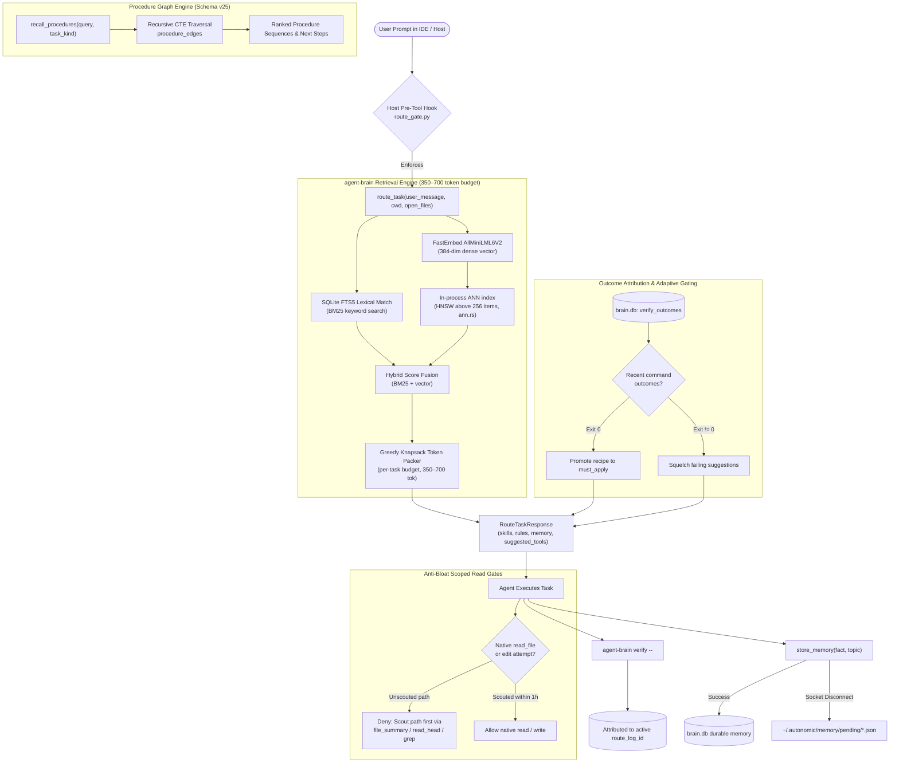

# agent-brain — Deep Operational & Architectural Context for Agents

> **Cognitive Core, Persistent Volume, Turn Router & Procedure Graph** — In-depth architectural guide, mental model, complete CLI matrix, MCP tool contracts, and failure recovery runbooks for `agent-brain`.  
> **Ecosystem Version Baseline:** `v1.0.0-rc7` (Schema v25)  
> **Documentation Hub:** [https://autonomic-ai.dev/docs/memory](https://autonomic-ai.dev/docs/memory) · [Architecture Hub](https://autonomic-ai.dev/docs/architecture)  
> **Default Storage:** `~/.autonomic/memory/` (`brain.db`, `packages/`, `pending/`, `serve.lock`)

---

## 1. Executive Summary & Biological Role

**`agent-brain`** is a local-first turn router and long-term memory engine designed to solve the two fundamental failure modes of modern agentic coding:
1. **Context Bloat & Token Degradation:** When entire documentation libraries, rules, and large repositories are dumped into LLM prompts, models suffer from "Lost-in-the-Middle" drift, degraded instruction following, and token costs. `agent-brain` dynamically selects and injects a ranked, relevance-scored subset of skills, conventions, and memory facts within a per-task budget of **350–700 tokens** per turn.
2. **Loss of Inter-Session Knowledge:** Standard agent chats lose all architectural context, conventions, and test outcomes the moment a session closes. `agent-brain` maintains an embedded vector database (`sqlite-vec` + HNSW) with hybrid BM25 full-text indexing, learning durable facts and attributing tool outcomes across sessions.

`agent-brain` operates in two complementary modes:
- **Direct Mode (stdio MCP):** Spawned directly by developer IDEs (Cursor, Claude Code, OpenCode, Codex, Gemini CLI, Antigravity) to route every turn via `route_task` and enforce the gate. VS Code and GitHub Copilot get instructions only; they have no gate hook.
- **Upstream MCP (optional):** Tools from MCP servers the user configures are listed in `suggested_tools`. Routing works without any upstream server.

---

## 2. Core Architecture & Turn Lifecycle



### 2.1 The Seven-Step Turn Lifecycle

1. **Turn Start (Compulsory Gate):** Before an agent calls any native tools (reading files, executing commands), the host hook (`hooks/route_gate.py`) verifies that `route_task` has been called for the current prompt. If not, native tools are blocked.
2. **Hybrid Context Retrieval:** `agent-brain` computes an embedding using local ONNX `AllMiniLML6V2` (384 dimensions) and combines it with BM25 full-text match over indexed skills, rules, and memory facts.
3. **Adaptive Tool Suggestion & Adherence Gating:**
   - Historical outcomes stored in `brain.db` (`verify_outcomes`) are queried.
   - Successful recipes (exit `0`) are elevated into `must_apply` constraints, forcing adherence.
   - Failing recipes (exit `!= 0`) are squelched to prevent repeating failed paths.
   - Tools from configured upstream MCP servers are recommended via `suggested_tools`.
4. **Scoped Read Gating (Anti-Bloat Protocol):**
   - Direct calls to native full-file reads are restricted.
   - Agents must first scout paths using token-bounded utilities: `file_summary`, `read_file_head`, `read_file_tail`, or `grep_search`.
   - Scouting a file automatically unlocks native `read_file` and editing for that file path for 3,600 seconds (`scout_unlock_secs`).
5. **Execution & Workflow Delegation:** The agent performs edits and executes commands. For multi-step tasks, the agent runs an `agent-spine` workflow with `agent-spine run --workflow <name>`.
6. **Closed-Loop Verification & Trajectory Ingestion:** Command execution is run or recorded via `agent-brain verify -- <cmd>` (or `--source orchestrator`). This links the execution outcome to the current `route_log_id` for reinforcement learning. Automated trajectory capture concurrently logs the executed transition into `workflow_trajectory` and builds the procedure graph (`procedure_edges`) for subsequent procedural recall.
7. **Memory Persistence:** At milestone completion, the agent calls `store_memory` with a concise fact (max 50 words). If the host MCP socket disconnects unexpectedly, the resilient fallback queue stores the fact to `~/.autonomic/memory/pending/`.

---

## 3. Trusted Verification Architecture

Not all test execution signals are created equal. `agent-brain` enforces a strict trust hierarchy:

| Source | Invocation | Trust Level | Use Case |
| :--- | :--- | :--- | :--- |
| `orchestrator` | `agent-brain verify --source orchestrator -- <cmd>` | **Fully Trusted** | CI runs, autonomous spine nodes, verified harness |
| `cli` | `agent-brain verify -- <cmd>` | **Trusted if Allowlisted** | Human or agent shell execution against `.verify/verify.toml` |
| `hook` | PostToolUse shell capture hook | **Observational** | Background telemetry, requires allowlist match |
| `mcp` / `playbook` | `record_verify_outcome` tool | **Untrusted for Learning** | Advisory only; cannot grant credit to recipes |

### Project Allowlist (`.verify/verify.toml`)
To prevent arbitrary commands from claiming verification credit, each target project defines allowed verification commands:
```toml
[verify]
commands = [
  "cargo test",
  "cargo check --all-targets",
  "npm test",
  "npm run check",
  "pytest"
]
max_execution_secs = 300
```
Scaffold a new project verify suite via: `agent-brain verify init`.

---

## 4. Complete CLI Command Reference & Flags

`agent-brain` provides a rich, modular CLI interface organized by operational domains:

### 4.1 Server & Lifecycle
- `agent-brain serve`: Run the MCP server over stdio. Host runtimes start it.
- `agent-brain version`: Print the installed version.
- `agent-brain onboarding`: Print the getting-started checklist.

### 4.2 Host Installation & Setup
- `agent-brain install`: Configure the MCP entry, hooks and rules for an editor host.
  - `--global`: User/global scope, where the host supports it.
  - `--all`: All hosts listed below, at user/global scope.
  - Host flags: `--claude-code`, `--claude-desktop`, `--vscode`, `--opencode`, `--codex`, `--gemini`, `--antigravity`.
  - `--reload`: Refresh the Cursor MCP entry after install.
  - `--starter`: Also install the `@starter` pack.

### 4.3 Diagnostic & Health Audit
- `agent-brain doctor`: Check the MCP install, binary, hooks and codesign.
  - `--fix`: Re-sign the binary (macOS), align `mcp.json`, and refresh hooks.

### 4.4 Package & Registry Management
- `agent-brain package add <SOURCE>`: Install a package from an `@alias`, `owner/repo`, or GitHub URL. Options: `--ref`, `--no-index`.
- `agent-brain package list`: List installed packages and their local paths.
- `agent-brain package update [NAME]`: Update one package, or all.
- `agent-brain package remove <NAME>`: Remove a package and purge its indexed items.
- `agent-brain registry list [--kind skill_package|utility|workflow]`: Show curated aliases.
- `agent-brain registry sync [--local]`: Refresh the registry cache.

### 4.5 Memory & GC Operations
- `agent-brain remember --text TEXT --tag TAG [--tag TAG ...] [--source SOURCE]`: Store one durable fact. The first tag becomes its topic.
- `agent-brain recall`: Read stored facts as JSON, by tag, query, age, or similarity.
- `agent-brain memory gc [--apply] [--stale-days N] [--very-stale-days N]`: Archive stale facts. Dry run unless `--apply`.
- `agent-brain memory observe`: Run an observation pass over recent activity.
- `agent-brain memory extract`: Explain or extract pending traces.
- `agent-brain gc [--min-confidence N] [--max-age-days N]`: Deduplicate, prune and vacuum the database.
- `agent-brain suggest-memory [approve|reject]`: Show, commit or discard a pending hook suggestion.
- `agent-brain promote list|approve|reject`: Review skills staged from session traces. Requires a human decision.

### 4.6 Verification & Ops
- `agent-brain verify init [--force] [--dir DIR]`: Scaffold `.verify/verify.toml`, `run.sh` and a README.
- `agent-brain verify [--source cli|orchestrator] -- <CMD> [ARGS...]`: Run an allowlisted command and record its exit code.
- `agent-brain verify record --exit N -- <CMD SUMMARY...>`: Record an outcome without running the command.
- `agent-brain verify run [--project DIR] [--json]`: Run the project's verify harness.
- `agent-brain briefing`: Print a summary of the last `route_task` decision.
- `agent-brain report`: Print the verify report by source. Runs without a `--help` entry.
- `agent-brain status`: Print the brain status for the current directory.
- `agent-brain stats [--days N] [--json]`: Route, cache, token-tool and memory counters. Latency is shown as an average and P95.
- `agent-brain dashboard [--days N]`: Write a local HTML page with total tokens saved.
- `agent-brain inspect log|fact|conflicts`: Inspect retrieval logs, a stored fact, or topic conflicts.
- `agent-brain learn url <HTTPS_URL> [--topic NAME] [--dry-run]`: Ingest allowlisted docs. `learn allowlist` shows the allowed domains.
- `agent-brain index [-c|--changed-only] [--no-ast]`: Reindex skills, rules and memory.

### 4.7 Synchronization & Session Digest
- `agent-brain export [DIR]`: Write a sync bundle.
- `agent-brain import <DIR> [--policy POLICY]`: Import a sync bundle.
- `agent-brain sync status|restore|git init|git clone|git push|git pull`: Git sync and conflict restore.
- `agent-brain sessions ingest [--source SRCS] [--legacy]`: Import session digests from cursor, codex, gemini and opencode.
- `agent-brain sessions status`: Show discoverable and stored session digests.
- `agent-brain bootstrap --remote <URL> [--skip-install]`: Bootstrap this device from a shared sync repo. Runs without a `--help` entry.

---

## 5. Model Context Protocol (MCP) Tool Specifications

When running in stdio MCP mode (`agent-brain serve`), the following tools are exposed to the AI host:

### 5.1 `route_task` (Primary Cognitive Router)
- **Description:** Mandatory turn router. Selects top-ranked skills, rules, and memory facts within a per-task budget of 350–700 tokens, unlocks native read tools for candidate paths, and suggests upstream tools based on verified recipes.
- **Parameters:**
  - `user_message` (string, required): The user prompt or instruction for the active turn.
  - `current_working_directory` (string, required): Absolute path of the current project root.
  - `open_files` (array of strings, optional): Files currently open in the editor buffers.
- **Return Object:**
  - `relevant_skills`: List of skill names and summaries relevant to the task.
  - `must_apply`: Mandatory rule constraints and verified recipe commands.
  - `system_instructions`: Budgeted, synthesized context text.
  - `suggested_tools`: Recommended tools from configured upstream MCP servers.
  - `memory_facts`: Retained long-term memory points.
  - `route_log_id`: Unique trace identifier for outcome attribution.

### 5.2 `store_memory`
- **Description:** Stores durable knowledge or convention across sessions. Use for stable project rules, dependency requirements, and architectural decisions.
- **Parameters:**
  - `fact` (string, required): Concise statement of fact (max 50 words).
  - `topic` (string, required): Category tag (e.g., `build`, `database`, `auth`, `styling`).
  - `confidence` (float, optional, default `1.0`): Confidence score between 0.0 and 1.0.

### 5.3 `list_memory` & `delete_memory`
- **`list_memory` Parameters:** `topic` (string, optional), `limit` (integer, optional).
- **`delete_memory` Parameters:** `memory_id` (integer, required).

### 5.4 Token-Bounded File Scouting Tools
- **`file_summary`**: Returns line count, AST outline, imports, and top-level symbols without loading full file bytes.
  - Parameters: `file_path` (string, required).
- **`read_file_head`**: Read the first N lines of a file (default: 50 lines).
  - Parameters: `file_path` (string, required), `lines` (integer, optional).
- **`read_file_tail`**: Read the last N lines of a file (default: 50 lines).
  - Parameters: `file_path` (string, required), `lines` (integer, optional).
- **`grep_search`**: Search for regex pattern in a file or directory with line count limits.
  - Parameters: `pattern` (string, required), `path` (string, optional), `max_matches` (integer, optional).

*Note: Calling any of these scouting tools on a file path automatically unlocks native `read_file` and `replace_file_content` for that path for 1 hour.*

### 5.5 `route_to_mcp` (Gateway Federation)
- **Description:** Delegates tool invocations to a configured upstream MCP server.
- **Parameters:**
  - `server` (string, required): Upstream server identifier from the user's MCP configuration.
  - `tool` (string, required): Upstream tool name, as listed in `suggested_tools`.
  - `arguments` (object, required): Tool arguments map.

### 5.6 `get_autonomic_catalog`
- **Description:** Returns the agent-brain and agent-spine capability catalog and delegation rules. Bypasses turn route gates to allow instant discovery.

### 5.7 `recall_procedures` (Procedure Graph Retrieval)
- **Description:** Recalls proven multi-step execution procedures matching a task query or kind, ranked by lexical match, task affinity, and historical success rate, with connected next-step graph nodes populated via recursive CTEs.
- **Parameters:**
  - `query` (string, required): Search query describing the procedural task or action.
  - `task_kind` (string, optional): Specific task category (e.g. `implementing`, `debugging`, `review`, `verification`, `architecture`).
  - `limit` (integer, optional, default: 5): Maximum number of ranked procedure sequences to return.
- **Return Object:**
  - Array of procedure matches containing `workflow_id`, `node_id`, `outcome`, `task_kind`, `score`, `success_rate`, `total_runs`, and `next_nodes`.

---

## 6. Filesystem & Configuration Schema

### 6.1 Directory Layout
```text
~/.autonomic/memory/
├── brain.db                 # SQLite database (tables: memories, skills, verify_outcomes, route_logs, workflow_trajectory, procedure_edges)
├── brain.db-wal             # Write-Ahead Log
├── brain.db-shm             # Shared memory index
├── serve.lock               # PID advisory lock for exclusive stdio serve
├── packages/                # Installed skill packages (~/.autonomic/memory/packages/)
│   └── skills/              # Cloned and indexed skills
└── pending/                 # Resilient fallback memory queue
    └── pending_*.json       # Uncommitted memory facts awaiting flush
```

### 6.2 Configuration File (`config.yaml` in the brain home)

The brain home is `~/.autonomic/memory` by default; set `AGENT_BRAIN_HOME` to change it. Settings are read from `config.yaml` there, and missing keys use their defaults.

```yaml
auto_update:
  enabled: false
routing:
  session_stickiness_secs: 1800  # Reuse warm route cache across turns in the same IDE session
  turn_ttl_secs: 60              # Freshness TTL for route cache keys
  auto_trajectory: true          # Automatically record execution transitions into procedure DAG
upstream_mcp:
  enabled: false                 # route_to_mcp to MCP servers you configure
  servers: []
memory_gc:
  stale_days: 90
```

---

## 7. Troubleshooting & Recovery Runbook

### 7.1 Problem: `serve.lock` Collision / "Another instance is running"
- **Cause:** A previous IDE session terminated abruptly without releasing the advisory file lock.
- **Resolution:**
  ```bash
  # Check which process holds the lock
  lsof ~/.autonomic/memory/serve.lock
  # If orphaned, run doctor auto-fix
  agent-brain doctor --fix
  ```

### 7.2 Problem: macOS "Developer Cannot Be Verified" / Quarantine Block
- **Cause:** Apple Gatekeeper quarantine flag set on downloaded release binary.
- **Resolution:**
  ```bash
  # Clear quarantine without breaking Apple Developer ID notarization
  xattr -d com.apple.quarantine $(which agent-brain)
  agent-brain doctor --fix
  ```

### 7.3 Problem: Disconnected MCP Dropped Memory Facts
- **Cause:** IDE socket was killed while `store_memory` was executing.
- **Resolution:**
  ```bash
  # Check if pending facts exist
  ls -la ~/.autonomic/memory/pending/
  # Flush pending facts into brain.db
  agent-brain memory flush-pending
  ```

### 7.4 Problem: Slow Route Latency or Bloated Vector Index
- **Cause:** Fragmented SQLite database after thousands of turn route logs.
- **Resolution:**
  ```bash
  # Run memory deduplication, prune stale logs, and vacuum DB
  agent-brain gc --apply
  # Re-index all packages and rules
  agent-brain index
  ```
