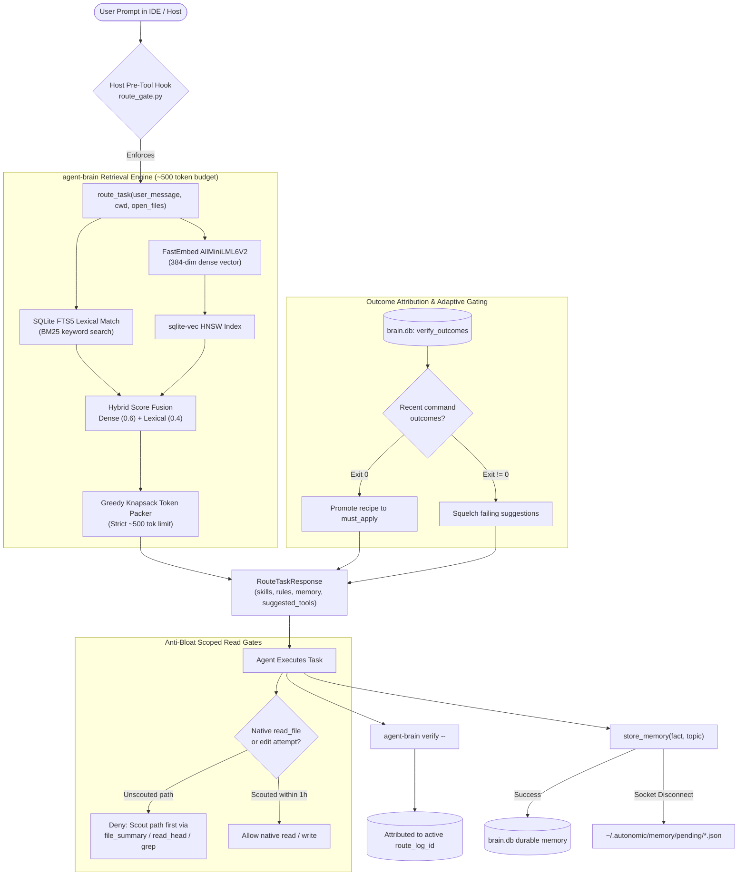

# agent-brain — Deep Operational & Architectural Context for Agents

> **Cognitive Core, Persistent Volume & Turn Router** — In-depth architectural guide, mental model, complete CLI matrix, MCP tool contracts, and failure recovery runbooks for `agent-brain`.  
> **Ecosystem Version Baseline:** `v1.0.0-beta.3.2`  
> **Documentation Hub:** [https://autonomic-ai.dev/docs/memory](https://autonomic-ai.dev/docs/memory) · [Architecture Hub](https://autonomic-ai.dev/docs/architecture)  
> **Default Storage:** `~/.autonomic/memory/` (`brain.db`, `packages/`, `pending/`, `serve.lock`)

---

## 1. Executive Summary & Biological Role

In the Autonomic 11-organ architecture, **`agent-brain`** serves as the **Cognitive Core and Persistent Volume (PV)**. It acts as a local-first, sub-millisecond turn router and long-term memory engine designed to solve the two fundamental failure modes of modern agentic coding:
1. **Context Bloat & Token Degradation:** When entire documentation libraries, rules, and large repositories are dumped into LLM prompts (100K+ tokens), models suffer from severe "Lost-in-the-Middle" drift, degraded instruction following, and massive token costs. `agent-brain` dynamically selects and injects a ranked, relevance-scored subset of skills, conventions, and memory facts within a strict **~500-token budget** per turn.
2. **Loss of Inter-Session Knowledge:** Standard agent chats lose all architectural context, conventions, and test outcomes the moment a session closes. `agent-brain` maintains an embedded vector database (`sqlite-vec` + HNSW) with hybrid BM25 full-text indexing, learning durable facts and attributing tool outcomes across sessions.

`agent-brain` operates in two complementary modes:
- **Direct Mode (stdio MCP):** Spawned directly by developer IDEs (Cursor, Claude Code, OpenCode, VS Code, Antigravity) to intercept every turn via `route_task` and enforce policy gates with `< 30ms` latency.
- **Federated Mode (via `agent-body`):** Exposes upstream routing and tool suggestions to the `agent-body` unified gateway, coordinating with `agent-spine`, `agent-heart`, `agent-muscle`, and peripheral organs.

---

## 2. Core Architecture & Turn Lifecycle



### 2.1 The Seven-Step Turn Lifecycle

1. **Turn Start (Compulsory Gate):** Before an agent calls any native tools (reading files, executing commands), the host hook (`hooks/route_gate.py`) verifies that `route_task` has been called for the current prompt. If not, native tools are blocked.
2. **Hybrid Context Retrieval:** `agent-brain` computes an embedding using local ONNX `AllMiniLML6V2` (384 dimensions) and combines it with BM25 full-text match over indexed skills, rules, and memory facts.
3. **Adaptive Tool Suggestion & Adherence Gating:**
   - Historical outcomes stored in `brain.db` (`verify_outcomes`) are queried.
   - Successful recipes (exit `0`) are elevated into `must_apply` constraints, forcing adherence.
   - Failing recipes (exit `!= 0`) are squelched to prevent repeating failed paths.
   - Upstream tools from peripheral organs (`agent-body`, `agent-muscle`, `agent-spine`) are recommended via `suggested_tools`.
4. **Scoped Read Gating (Anti-Bloat Protocol):**
   - Direct calls to native full-file reads are restricted.
   - Agents must first scout paths using token-bounded utilities: `file_summary`, `read_file_head`, `read_file_tail`, or `grep_search`.
   - Scouting a file automatically unlocks native `read_file` and editing for that file path for 3,600 seconds (`scout_unlock_secs`).
5. **Execution & Workflow Delegation:** The agent performs edits and executes commands. For multi-step tasks, the agent delegates to `agent-spine` workflows or `agent-muscle` sandboxed execution via `route_to_mcp`.
6. **Closed-Loop Verification:** Command execution is run or recorded via `agent-brain verify -- <cmd>` (or `--source orchestrator`). This links the execution outcome to the current `route_log_id` for reinforcement learning.
7. **Memory Persistence:** At milestone completion, the agent calls `store_memory` with a concise fact (max 50 words). If the host MCP socket disconnects unexpectedly, the resilient fallback queue stores the fact to `~/.autonomic/memory/pending/`.

---

## 3. Trusted Verification Architecture

Not all test execution signals are created equal. `agent-brain` enforces a strict trust hierarchy:

| Source | Invocation | Trust Level | Use Case |
| :--- | :--- | :--- | :--- |
| `orchestrator` | `agent-brain verify --source orchestrator -- <cmd>` | **Fully Trusted** | CI runs, autonomous spine nodes, verified harness |
| `cli` | `agent-brain verify -- <cmd>` | **Trusted if Allowlisted** | Human or agent shell execution against `.verify/verify.toml` |
| `hook` | PostToolUse shell capture hook | **Observational** | Background telemetry, requires allowlist match |
| `mcp` / `playbook` | `record_verify_outcome` tool | **Untrusted for Learning** | Advisory only; cannot grant credit to recipes |

### Project Allowlist (`.verify/verify.toml`)
To prevent arbitrary commands from claiming verification credit, each target project defines allowed verification commands:
```toml
[verify]
commands = [
  "cargo test",
  "cargo check --all-targets",
  "npm test",
  "npm run check",
  "pytest"
]
max_execution_secs = 300
```
Scaffold a new project verify suite via: `agent-brain verify init`.

---

## 4. Complete CLI Command Reference & Flags

`agent-brain` provides a rich, modular CLI interface organized by operational domains:

### 4.1 Server & Lifecycle
- `agent-brain serve`: Run the MCP server over stdio (used by Cursor, Claude Code, etc.).
  - `--config <PATH>`: Custom path to configuration file (default: `~/.agent_brain/config.yaml` or `~/.autonomic/config.toml`).
- `agent-brain version`: Print semantic version, commit hash, and target architecture.
- `agent-brain onboarding`: Run interactive 5-minute getting-started checklist.

### 4.2 Host Installation & Setup
- `agent-brain install`: Configure MCP server, hooks, and user rules for supported IDEs.
  - `--global`: Apply configurations globally across the user environment.
  - `--all`: Install to all detected host environments.
  - Individual host flags: `--cursor`, `--claude-code`, `--claude-desktop`, `--vscode`, `--opencode`, `--codex`, `--gemini`, `--antigravity`.
  - `--mode-only`: Only write system instruction rules snippets without modifying editor MCP configs.

### 4.3 Diagnostic & Health Audit
- `agent-brain doctor`: Comprehensive pre-flight health audit.
  - `--fix`: Automatically clear macOS quarantine attributes (`xattr -cr`), fix broken advisory locks, and re-scaffold missing directories.
  - `--quick`: Skip slow embedding model integrity checks.
  - `--stats`: Output database row counts, index sizes, and route telemetry.

### 4.4 Package & Registry Management
- `agent-brain package add <PACKAGE>`: Install a skill package (supports `@alias`, `owner/repo` GitHub shorthand, or full Git URL).
- `agent-brain package remove <PACKAGE>`: Remove an installed skill package.
- `agent-brain package list`: List all installed skill packages and their status.
- `agent-brain registry list`: Display curated skill packages from the official catalog (e.g. `@matt-skills`, `@coding-policy`, `@official`).
- `agent-brain registry sync`: Update local catalog cache from upstream registry.

### 4.5 Memory & GC Operations
- `agent-brain memory put --topic <TOPIC> --fact <FACT> [--confidence <FLOAT>]`: Insert durable memory fact from CLI.
- `agent-brain memory get <ID>`: Retrieve memory fact details by ID.
- `agent-brain memory list [--topic <TOPIC>] [--limit <N>]`: List stored memory facts.
- `agent-brain memory enqueue --topic <TOPIC> --fact <FACT>`: Manually write to pending fallback queue.
- `agent-brain memory flush-pending`: Ingest and index all files in `~/.autonomic/memory/pending/`.
- `agent-brain gc [--dry-run] [--apply]`: Deduplicate similar facts, prune low-confidence memories, and vacuum SQLite DB.
- `agent-brain suggest-memory`: Review anti-pattern suggestions captured by hooks.
- `agent-brain promote <STAGED_ID>`: Approve or reject candidate skills staged from session traces.

### 4.6 Verification & Ops
- `agent-brain verify init`: Scaffold `.verify/verify.toml`, executable `run.sh`, and `README.md`.
- `agent-brain verify [--source <SOURCE>] -- <COMMAND>`: Execute command, capture exit code and duration, and log trusted verification outcome.
- `agent-brain verify record --command <CMD> --exit <CODE> [--source <SRC>]`: Record outcome without running command directly.
- `agent-brain report`: Display aggregate verification statistics by source and project.
- `agent-brain briefing`: Print human-readable summary of the last `route_task` execution.
- `agent-brain stats`: Show route latency percentiles (p50, p95, p99) and cache hit rates.
- `agent-brain dashboard`: Generate and open local HTML metrics dashboard.
- `agent-brain inspect`: Search and debug route logs, vector rankings, and conflict tables.
- `agent-brain learn <URL_OR_PATH>`: Ingest documentation or reference markdown into skills and memory.
- `agent-brain index`: Force full reindexing of all installed skills, rules, and vector embeddings.

### 4.7 Synchronization & Session Digest
- `agent-brain export [--output <BUNDLE.tar.gz>]`: Create portable archive of memory, skills, and configuration.
- `agent-brain import <BUNDLE.tar.gz>`: Ingest an exported sync bundle into local brain.
- `agent-brain sync git <REMOTE_URL>`: Synchronize knowledge store with a private Git repository.
- `agent-brain bootstrap <REMOTE_URL>`: Join a cluster by bootstrapping local brain from a shared repo.
- `agent-brain sessions ingest`: Ingest session transcripts and distill key architectural decisions.

---

## 5. Model Context Protocol (MCP) Tool Specifications

When running in stdio MCP mode (`agent-brain serve`), the following tools are exposed to the AI host:

### 5.1 `route_task` (Primary Cognitive Router)
- **Description:** Mandatory turn router. Selects top-ranked skills, rules, and memory facts within ~500 tokens, unlocks native read tools for candidate paths, and suggests upstream tools based on verified recipes.
- **Parameters:**
  - `user_message` (string, required): The user prompt or instruction for the active turn.
  - `current_working_directory` (string, required): Absolute path of the current project root.
  - `open_files` (array of strings, optional): Files currently open in the editor buffers.
- **Return Object:**
  - `relevant_skills`: List of skill names and summaries relevant to the task.
  - `must_apply`: Mandatory rule constraints and verified recipe commands.
  - `system_instructions`: Budgeted, synthesized context text.
  - `suggested_tools`: Recommended organ tools (`agent-body`, `agent-muscle`, etc.).
  - `memory_facts`: Retained long-term memory points.
  - `route_log_id`: Unique trace identifier for outcome attribution.

### 5.2 `store_memory`
- **Description:** Stores durable knowledge or convention across sessions. Use for stable project rules, dependency requirements, and architectural decisions.
- **Parameters:**
  - `fact` (string, required): Concise statement of fact (max 50 words).
  - `topic` (string, required): Category tag (e.g., `build`, `database`, `auth`, `styling`).
  - `confidence` (float, optional, default `1.0`): Confidence score between 0.0 and 1.0.

### 5.3 `list_memory` & `delete_memory`
- **`list_memory` Parameters:** `topic` (string, optional), `limit` (integer, optional).
- **`delete_memory` Parameters:** `memory_id` (integer, required).

### 5.4 Token-Bounded File Scouting Tools
- **`file_summary`**: Returns line count, AST outline, imports, and top-level symbols without loading full file bytes.
  - Parameters: `file_path` (string, required).
- **`read_file_head`**: Read the first N lines of a file (default: 50 lines).
  - Parameters: `file_path` (string, required), `lines` (integer, optional).
- **`read_file_tail`**: Read the last N lines of a file (default: 50 lines).
  - Parameters: `file_path` (string, required), `lines` (integer, optional).
- **`grep_search`**: Search for regex pattern in a file or directory with line count limits.
  - Parameters: `pattern` (string, required), `path` (string, optional), `max_matches` (integer, optional).

*Note: Calling any of these scouting tools on a file path automatically unlocks native `read_file` and `replace_file_content` for that path for 1 hour.*

### 5.5 `route_to_mcp` (Gateway Federation)
- **Description:** Delegates tool invocations to upstream `agent-body` or connected organ daemons.
- **Parameters:**
  - `server` (string, required): Upstream server identifier (e.g. `agent-body`).
  - `tool` (string, required): Upstream tool name (e.g. `muscle_execute_bash`, `spine_submit_workflow`).
  - `arguments` (object, required): Tool arguments map.

### 5.6 `get_autonomic_catalog`
- **Description:** Returns complete specifications, ports, and tool definitions across all 8 cluster organs. Bypasses turn route gates to allow instant discovery.

---

## 6. Filesystem & Configuration Schema

### 6.1 Directory Layout
```text
~/.autonomic/memory/
├── brain.db                 # SQLite database (tables: memories, skills, verify_outcomes, route_logs)
├── brain.db-wal             # Write-Ahead Log
├── brain.db-shm             # Shared memory index
├── serve.lock               # PID advisory lock for exclusive stdio serve
├── packages/                # Installed skill packages (~/.autonomic/memory/packages/)
│   └── skills/              # Cloned and indexed skills
└── pending/                 # Resilient fallback memory queue
    └── pending_*.json       # Uncommitted memory facts awaiting flush
```

### 6.2 Configuration File (`~/.autonomic/config.toml` or `~/.agent_brain/config.yaml`)
```toml
[brain]
home = "~/.autonomic/memory"
db_path = "~/.autonomic/memory/brain.db"
embedding_model = "AllMiniLML6V2"
route_gate_scope = "brain_mcp"   # "brain_mcp" (safe) | "all" (strict IDE lock)
read_gate = "hard"               # "hard" | "steer" | "off"
scout_unlock_secs = 3600         # duration native read is unlocked after scouting (1 hour)
allow_multi_serve = false        # advisory serve.lock enforcement
allow_python_shell = false       # block python -c / heredocs in agent terminal
max_budget_tokens = 500          # strict token limit for injected turn context
hybrid_dense_weight = 0.6        # weight for HNSW vector similarities
hybrid_lexical_weight = 0.4      # weight for FTS5 BM25 match
```

---

## 7. Troubleshooting & Recovery Runbook

### 7.1 Problem: `serve.lock` Collision / "Another instance is running"
- **Cause:** A previous IDE session terminated abruptly without releasing the advisory file lock.
- **Resolution:**
  ```bash
  # Check which process holds the lock
  lsof ~/.autonomic/memory/serve.lock
  # If orphaned, run doctor auto-fix
  agent-brain doctor --fix
  ```

### 7.2 Problem: macOS "Developer Cannot Be Verified" / Quarantine Block
- **Cause:** Apple Gatekeeper quarantine flag set on downloaded release binary.
- **Resolution:**
  ```bash
  # Clear quarantine without breaking Apple Developer ID notarization
  xattr -d com.apple.quarantine $(which agent-brain)
  agent-brain doctor --fix
  ```

### 7.3 Problem: Disconnected MCP Dropped Memory Facts
- **Cause:** IDE socket was killed while `store_memory` was executing.
- **Resolution:**
  ```bash
  # Check if pending facts exist
  ls -la ~/.autonomic/memory/pending/
  # Flush pending facts into brain.db
  agent-brain memory flush-pending
  ```

### 7.4 Problem: Slow Route Latency or Bloated Vector Index
- **Cause:** Fragmented SQLite database after thousands of turn route logs.
- **Resolution:**
  ```bash
  # Run memory deduplication, prune stale logs, and vacuum DB
  agent-brain gc --apply
  # Re-index all packages and rules
  agent-brain index
  ```
