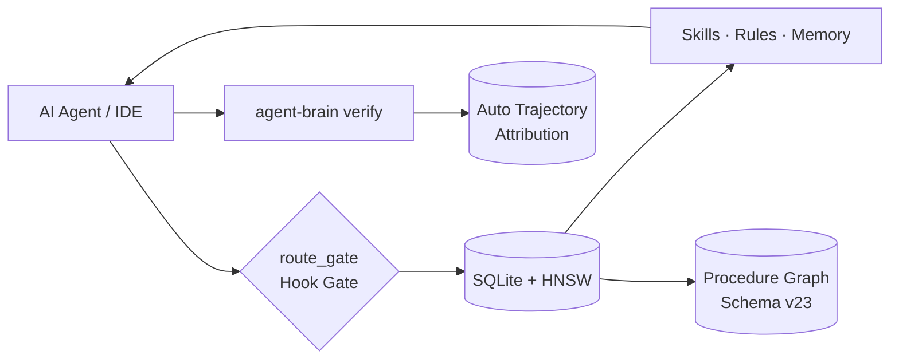

# agent-brain

Local-First Cognitive Governor, Turn Router & Procedure Graph for Coding Agents.

Part of [Autonomic AI](https://github.com/autonomic-ai-dev/agent-brain), together with agent-spine. Standalone over stdio for Cursor, Claude Code, OpenCode, Codex, Gemini, Antigravity, and VS Code.



| Problem in Modern Agent Tooling | agent-brain Solution | Verified Evidence |
|---------------------------------|----------------------|-------------------|
| Skill libraries blow context windows (100k+ tokens) | Turn router packs top-ranked skills into a strict ~500-token budget | Knapsack token packer, zero bloat |
| Turn instructions drift; agents ignore soft prompt rules | Host pre-tool hooks enforce `route_task` & sandwich policy anchors | `tests/jailbreak_routing.rs` (250/250 passed) |
| Unbounded agent shell execution poses security hazards | Deterministic `bash-gate` blocks destructive operations & bypasses | `tests/bash_gate.rs` (3/3 test suites passed) |
| Repetitive multi-step procedures lack persistent memory | Procedure Graph (`recall_procedures`) with recursive SQLite CTEs | Schema migration v23 (`procedure_edges`) |
| Closed-loop outcomes are discarded at session termination | Automatic trajectory capture and outcome reinforcement (exit 0 / != 0) | `verify.rs` & `trajectory.rs` auto-capture |
| Slow routing increases perceived latency | In-memory cache + session stickiness yield sub-millisecond warm hits | Micro-benchmark p95 ≤ 24ms, local SQLite |

Agent context: [CONTEXT.md](CONTEXT.md) · Memory & Context Routing Guide: [https://autonomic-ai.dev/docs/memory](https://autonomic-ai.dev/docs/memory) · Architecture: [https://autonomic-ai.dev/docs/architecture](https://autonomic-ai.dev/docs/architecture)

---

## Install

### Homebrew (macOS — Recommended)

```bash
brew tap autonomic-ai-dev/tap
brew install agent-brain
agent-brain install --global
```

### Direct Download / curl

Apple Silicon (Developer ID–signed release):

```bash
curl -fsSL https://raw.githubusercontent.com/autonomic-ai-dev/agent-brain/master/scripts/install.sh | bash -s -- --global
```

```bash
agent-brain version
agent-brain doctor
```

`install --global` writes MCP config, hooks, and mode snippets. Paste `~/.agent_brain/cursor-user-rules.mdc` into Cursor **User Rules**. The host spawns `serve` — you do not run it manually.

Local build: `make release-macos` (required for Cursor MCP), then `agent-brain install --global`.

Other hosts:

```bash
agent-brain install --all --global
# or: --claude-code | --codex | --opencode | --gemini | --antigravity | --vscode | --claude-desktop
```

Packages: `agent-brain registry list` · defaults `@matt-skills` · `agent-brain package add @supervisor`

---

## Commands

| Command | Purpose |
|---------|---------|
| `install --global` | MCP + hooks + permissions |
| `package add <pkg\|alias>` | Install skill package |
| `doctor` / `doctor --fix` | Health check (clears quarantine; does not re-sign) |
| `briefing` | Last `route_task` summary |
| `index` | Reindex skills/rules/memory |
| `verify init` | Scaffold `.verify/verify.toml`, executable `run.sh`, and `README.md` |
| `verify [--source cli\|orchestrator] -- <cmd>` | Run command & record trusted exit (prefer over MCP assert) |
| `verify record` / `report` | Record known exit · aggregate by source |
| `memory put\|enqueue\|flush-pending` | CLI write and retry fallback for durable facts |
| `sync git\|cloud …` | Multi-machine brain sync |
| `bootstrap` | Bootstrap new device into sync repo |

### Autonomic Capabilities & Adaptive Routing

- **Procedure Graph Retrieval (`recall_procedures`)**: Ranks multi-step execution procedures by exact `task_kind` match, lexical query relevance, and historical success rate, dynamically hydrating connected downstream nodes via SQLite recursive CTEs (`procedure_edges`, migration v23).
- **Automated Trajectory Ingestion**: Background capture into `workflow_trajectory` records execution steps and outcomes across `verify` and turn transitions behind a configurable toggle (`auto_trajectory = true`).
- **Sub-Millisecond Warm-Cache Routing**: In-memory LRU cache with session stickiness (`session_stickiness_secs = 1800`, `turn_ttl_secs = 60`) yields sub-millisecond route latency on repeated turns, with telemetry capturing cache hits in `retrieval_log`.
- **Jailbreak & Prompt Injection Defense**: Deterministic rejection and delimiter containment verified across 250 adversarial test cases (`tests/jailbreak_routing.rs`), preventing prompt overrides, delimiter breakout, and instruction drift.
- **Deterministic Shell Gate (`bash-gate`)**: Real-time command inspection blocks destructive file and Git operations (`rm -rf /`, `git push --force`, `--no-verify` bypasses) before execution (`tests/bash_gate.rs`).
- **Catalog Discovery**: `get_autonomic_catalog` MCP tool gives AI agents the agent-brain and agent-spine capability catalog and delegation rules without being blocked by route gates.
- **Adaptive Tool Suggestion**: Upstream tool recommendations in `route_task` dynamically evaluate historical `verify_outcomes` from `brain.db`, reinforcing tools that succeed and dampening those that fail.
- **Adherence Gating (`must_apply` Promotion)**: High-confidence verified recipes (exit `0`) are automatically elevated into `must_apply` constraints in `RouteTaskResponse`, converting advisory recommendations into mandatory execution directives.
- **Instant Failure Squelching**: When a command fails (`exit != 0`), its latest failure instantly removes it from few-shot recipe recommendations, preventing broken suggestions from propagating.
- **Automatic Outcome Attribution**: Command executions captured via `agent-brain verify` or host shell hooks automatically correlate with the active turn's `route_log_id`, boosting or penalizing retrieved context weights without manual feedback calls.
- **Elastic Token Budgeting**: Dynamically scales token budget according to task kind (Verification: 350, Review: 550, Implementing: 600, Debugging: 650, Architecture: 700 tokens), preventing token bloat while giving deep tasks sufficient budget.
- **Decoupled Memory Recall**: Memory score floor calculation decoupled from high-scoring rules, with a 120-token reservation ensuring relevant memory items are never starved out of the context budget.
- **agstack Mode Prioritization & Config Toggle**: Prioritizes `agstack-mode` at position #1 for all engineering tasks. Configurable via `config.yaml` (`routing: prefer_agstack: true/false`) or environment variable `AGENT_BRAIN_PREFER_AGSTACK=0` or `1`.
- **Silent Watcher Ambient Guidance**: Injects verified recipes and critical invariants ambiently into agent context on prompt submit (`AGENT_BRAIN_SILENT_WATCHER=1`) without requiring active agent tool calls.
- **Deferred Tool Hook Enforcement**: Strict hook enforcement (`GATE_SCOPE=all`) ensuring deferred-loading MCP environments (such as Claude Code) cannot bypass routing.

---

## Data

Default store: `~/.autonomic/memory/` (`brain.db`, packages, route logs). Override with `AGENT_BRAIN_HOME`. First start downloads the embedding model (~90MB).

---

## Architecture & Documentation

For complete architectural specifications, memory data flows, and MCP tool contracts, visit the centralized documentation hub:
- **Memory & Context Routing Guide**: [https://autonomic-ai.dev/docs/memory](https://autonomic-ai.dev/docs/memory)
- **Ecosystem Architecture**: [https://autonomic-ai.dev/docs/architecture](https://autonomic-ai.dev/docs/architecture)

---

## Development

```bash
cargo test --release -p agent-brain
make release-macos
```

Release CI publishes **`agent-brain-aarch64-apple-darwin`** only (signed at build). Install verifies the signature and never re-signs.

---

## License

MIT · [CHANGELOG](CHANGELOG.md)
