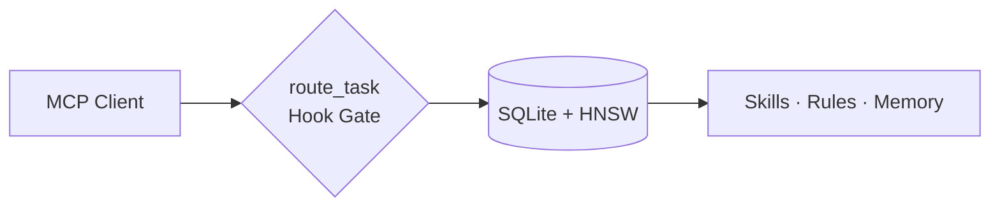

# agent-brain

Local MCP router that picks the right skills, rules, and memory for each agent turn (~500 tokens), and enforces `route_task` via host hooks.

Part of the [Autonomic AI](https://github.com/autonomic-ai-dev/agent-body) stack. Standalone over stdio for Cursor and other MCP hosts; optional cluster mode via `agent-nerves` / `autonomic serve-mcp`.



| Problem | Fix |
|---------|-----|
| Skill libraries blow the context window | `route_task` returns a small, ranked set |
| Soft “use skills” rules are ignored | Hooks block brain MCP tools until `route_task` |
| Conventions vanish between chats | `store_memory` + `must_apply` |
| MCP disconnects drop durable facts | Pending queue + `memory put` CLI fallback |
| Verifications lost across turns | Auto-record via hooks + `verify` / `report` |

Full usage: [docs/USAGE.md](docs/USAGE.md) · Agent context: [docs/CONTEXT.md](docs/CONTEXT.md) · Contract: [docs/AGENT-CONTEXT.md](docs/AGENT-CONTEXT.md) · Hosts: [docs/host-integration.md](docs/host-integration.md) · Architecture: [https://autonomic-ai.dev/docs/architecture](https://autonomic-ai.dev/docs/architecture) · CI path filters: [docs/ci-path-filter-pattern.md](docs/ci-path-filter-pattern.md)

---

## Install

### Homebrew (macOS — Recommended)

```bash
brew tap autonomic-ai-dev/tap
brew install agent-brain
agent-brain install --global
```

### Direct Download / curl

Apple Silicon (Developer ID–signed release):

```bash
curl -fsSL https://raw.githubusercontent.com/autonomic-ai-dev/agent-brain/master/scripts/install.sh | bash -s -- --global
```

```bash
agent-brain version
agent-brain doctor
```

`install --global` writes MCP config, hooks, and mode snippets. Paste `~/.agent_brain/cursor-user-rules.mdc` into Cursor **User Rules**. The host spawns `serve` — you do not run it manually.

Local build: `make release-macos` (required for Cursor MCP), then `agent-brain install --global`.

Other hosts:

```bash
agent-brain install --all --global
# or: --claude-code | --codex | --opencode | --gemini | --antigravity | --vscode | --claude-desktop
```

Packages: `agent-brain registry list` · defaults `@matt-skills` · `agent-brain add @supervisor`

---

## Commands

| Command | Purpose |
|---------|---------|
| `install --global` | MCP + hooks + permissions |
| `add <pkg\|owner/repo>` | Install skill package |
| `doctor` / `doctor --fix` | Health check (clears quarantine; does not re-sign) |
| `briefing` | Last `route_task` summary |
| `index` | Reindex skills/rules/memory |
| `verify init` | Scaffold `.verify/verify.toml`, executable `run.sh`, and `README.md` |
| `verify [--source cli\|orchestrator] -- <cmd>` | Run command & record trusted exit (prefer over MCP assert) |
| `verify record` / `report` | Record known exit · aggregate by source |
| `memory put\|enqueue\|flush-pending` | CLI write and retry fallback for durable facts |
| `sync git\|cloud …` | Multi-machine brain sync |
| `bootstrap` | Bootstrap new device into sync repo |

### Autonomic Capabilities & Adaptive Routing

- **Organ Catalog Discovery**: `get_autonomic_catalog` MCP tool gives AI agents complete specifications and tool definitions across all 8 cluster organs without being blocked by route gates.
- **Adaptive Tool Suggestion**: Upstream tool recommendations in `route_task` dynamically evaluate historical `verify_outcomes` from `brain.db`, reinforcing tools that succeed and dampening those that fail.
- **Adherence Gating (`must_apply` Promotion)**: High-confidence verified recipes (exit `0`) are automatically elevated into `must_apply` constraints in `RouteTaskResponse`, converting advisory recommendations into mandatory execution directives.
- **Instant Failure Squelching**: When a command fails (`exit != 0`), its latest failure instantly removes it from few-shot recipe recommendations, preventing broken suggestions from propagating.
- **Automatic Outcome Attribution**: Command executions captured via `agent-brain verify` or host shell hooks automatically correlate with the active turn's `route_log_id`, boosting or penalizing retrieved context weights without manual feedback calls.

---

## Data

Default store: `~/.autonomic/memory/` (`brain.db`, packages, route logs). Override with `AGENT_BRAIN_HOME`. First start downloads the embedding model (~90MB).

---

## Architecture

For the complete 11-organ architecture specification, data flows, and MCP tool contracts, see the centralized [Autonomic AI Architecture Hub](https://autonomic-ai.dev/docs/architecture).

---

## Development

```bash
cargo test --release -p agent-brain
make release-macos
```

Release CI publishes **`agent-brain-aarch64-apple-darwin`** only (signed at build). Install verifies the signature and never re-signs.

---

## License

MIT · [CHANGELOG](CHANGELOG.md)
