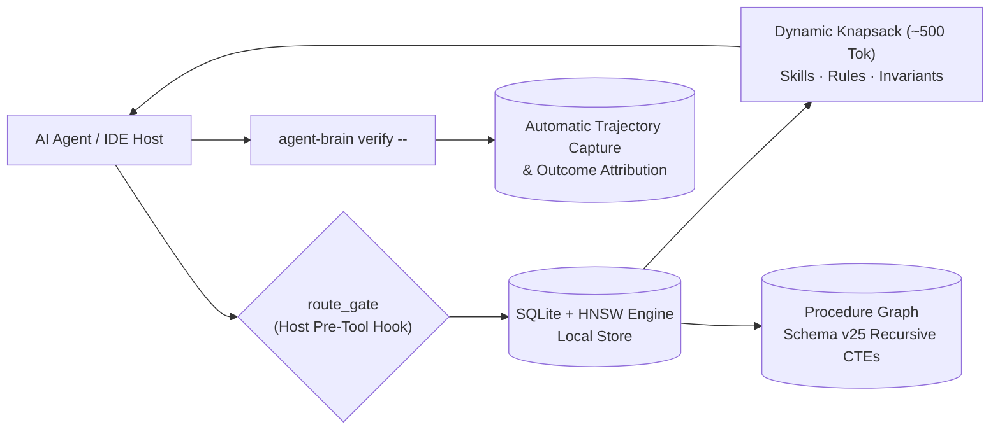

# agent-brain

> **Local-First Cognitive Governor, Turn Router & Procedure Graph for Coding Agents.**

[](CHANGELOG.md)
[](LICENSE)
[-lightgrey.svg)](https://autonomic-ai.dev)
[](https://autonomic-ai.dev)

Part of [Autonomic AI](https://autonomic-ai.dev), alongside [agent-spine](https://github.com/autonomic-ai-dev/agent-spine). Operates locally via standard stdio MCP and native host hooks across **Claude Code**, **Cursor**, **Antigravity (AGY)**, **OpenCode**, **Codex**, **Gemini CLI**, and **VS Code**.

---

## Architectural Overview



---

## Why agent-brain?

| Challenge in Coding Agent Tooling | agent-brain Solution | Verified Mechanism |
| :--- | :--- | :--- |
| **Context Window Bloat (100k+ tokens)** | Turn router packs the top-ranked skills, rules and memory into a fixed per-task token budget (350–700 tokens) | Knapsack token packer with a 120-token memory reservation (`engine.rs`) |
| **Instruction Drift & Ignored Prompts** | Host pre-tool hooks enforce `route_task` and sandwich policy anchors on every turn | Routing regression suite (`agent-brain/tests/jailbreak_routing.rs`, 250 cases) passes |
| **Destructive Shell Hazards** | Real-time AST and bash parser blocks dangerous operations before execution | Deterministic `bash-gate` (fail-closed security) |
| **Repetitive Execution Amnesia** | Procedure Graph (`recall_procedures`) stores structured, multi-step execution graphs | Schema v25 SQLite recursive CTEs (`procedure_edges`) |
| **Discarded Verification Evidence** | Automatic trajectory capture and outcome attribution (exit 0 vs non-zero) | `verify.rs` & `trajectory.rs` closed loop |
| **High Prompt Turn Latency** | Turn cache and session stickiness reuse recent routing decisions | `routing.turn_ttl_secs`, `routing.session_stickiness_secs` (`config.rs`) |

---

## Why teams adopt it

**1. Proof on day one.** `agent-brain dashboard` writes a local HTML page with total tokens saved by routing and bounded reads, route counts and latency. Run it after your first session:

```bash
agent-brain dashboard --days 7
```

`agent-brain stats` prints the route, cache and token-tool counters in the terminal. It does not print a tokens-saved total; the dashboard does.

**2. One install for every host.** One binary configures Claude Code, Cursor, Codex, Gemini CLI and OpenCode:

```bash
agent-brain install --all --global
```

Antigravity and VS Code are available per host (`--antigravity`, `--vscode`). Hook enforcement is not available on every host; see the Supported Runtimes table below.

**3. Local and private.** Routing, memory, verification and the token budget run on your machine against a local SQLite database. The route path makes no network calls. Outbound network happens only for the one-time embedding model download on first use, and for commands you run yourself: `learn`, `package add`, extension install and `sync cloud`. Nothing is sent to a hosted service by default.

---

## Supported Runtimes

| Runtime | Hook Mode | Integration Type |
| :--- | :--- | :--- |
| **Claude Code** | PreToolUse Hook | Native CLI stdio MCP + route gate |
| **Cursor** | Pre-Tool Execution Hook | `.cursor/mcp.json` + `cursor-user-rules.mdc` |
| **Antigravity (AGY)** | BeforeTool Hook | Native CLI stdio MCP + route gate |
| **OpenCode** | Session / Tool Plugin | `agent-brain-route-gate.js` v2 plugin |
| **Codex CLI / Gemini CLI** | Shell / Tool Hooks | Direct stdio MCP client |
| **VS Code** | Extension MCP | Stdio bridge via `~/.autonomic/config.yaml` |

---

## Quickstart & Installation

### Option 1: Homebrew (macOS — Recommended)

```bash
brew tap autonomic-ai-dev/tap
brew install agent-brain
agent-brain install --global
```

### Option 2: Direct Download / Curl (Apple Silicon Developer ID–Signed)

```bash
curl -fsSL https://raw.githubusercontent.com/autonomic-ai-dev/agent-brain/master/scripts/install.sh | bash -s -- --global
```

### Option 3: Compile From Source (Rust)

```bash
git clone https://github.com/autonomic-ai-dev/agent-brain.git
cd agent-brain
cargo build --release -p agent-brain
./target/release/agent-brain install --global
```

### Verify Host Installation

```bash
agent-brain version
agent-brain doctor
```

`install --global` writes MCP configuration, hooks, and mode snippets. Paste `~/.agent_brain/cursor-user-rules.mdc` into Cursor **User Rules** if using Cursor. The host runtime spawns `serve` automatically over stdio.

To target specific agent runtimes:

```bash
agent-brain install --all --global
# or selectively: --claude-code | --cursor | --opencode | --gemini | --antigravity | --vscode | --codex
```

---

## Core Pillars

### 1. Dynamic Cognitive Governor (Token Knapsack)
Instead of dumping full documentation trees into your agent's system prompt, `agent-brain` intercepts each turn and calculates an exact token knapsack. Token budgets scale elastically by task kind:
- **Verification**: 350 tokens
- **Code Review**: 550 tokens
- **Implementation**: 600 tokens
- **Debugging**: 650 tokens
- **Architecture**: 700 tokens

A dedicated 120-token reservation prevents memory starvation, ensuring durable project learnings are never crowded out by active rules.

### 2. Procedure Graph & Associative Memory
Built on local SQLite with schema v25 migrations, `recall_procedures` queries multi-step engineering recipes. Connected downstream procedures and dependent execution nodes are dynamically hydrated using SQLite recursive Common Table Expressions (`procedure_edges`), ranked by task similarity and historical pass rate.

### 3. Deterministic Security & Host Hook Enforcement (`bash-gate`)
Agent execution is governed by fail-closed hooks:
- **`route_gate`**: Ensures no agent tool call executes without fresh turn routing and policy injection.
- **`bash-gate`**: Real-time parser inspecting shell commands and script contents (`bash`, `sh`, `source`, executable scripts). Prohibits catastrophic commands (`rm -rf /`, force-pushes, `--no-verify` flags, security bypasses) before execution occurs.

### 4. Closed-Loop Verification & Trajectory Attribution
Verified test runs executed through `agent-brain verify -- <cmd>` are recorded with cryptographic and telemetry guarantees:
- Successful runs (exit `0`) elevate applied recipes into mandatory `must_apply` constraints for subsequent turns.
- Failed runs (exit `!= 0`) squelch broken recipes immediately from context recommendations.
- Execution steps are automatically captured in `workflow_trajectory` (`auto_trajectory = true`), linking real build and test outcomes to turn logs.

---

## CLI Reference

| Command | Description |
| :--- | :--- |
| `agent-brain install --global` | Configure MCP server, host hooks, and runtime permissions |
| `agent-brain doctor` / `--fix` | Diagnostic health check (validates binary, hooks, SQLite store) |
| `agent-brain briefing` | Summarizes last `route_task` decision and active token budget |
| `agent-brain stats` | Route, cache, token-tool and memory counters for the last period |
| `agent-brain dashboard [--days N]` | Writes the local HTML page with total tokens saved |
| `agent-brain index` | Indexes local skills, rules, and workspace memory into SQLite |
| `agent-brain verify -- <cmd>` | Execute and record verified command with trusted exit attribution |
| `agent-brain remember --text TEXT --tag TAG` | Store one durable fact or architectural decision |
| `agent-brain package add <pkg>` | Install skill packages from registry (e.g. `@supervisor`, `@matt-skills`) |
| `agent-brain sync git\|cloud` | Synchronize memory graph and skills across development machines |

---

## Configuration & Local Store

Configuration resides in `~/.autonomic/config.yaml` or `~/.autonomic/memory/config.json`:

```yaml
routing:
  prefer_agstack: true
  auto_trajectory: true
  turn_ttl_secs: 60
  session_stickiness_secs: 1800
```

- **Default Database**: `~/.autonomic/memory/brain.db` (override with `AGENT_BRAIN_HOME`).
- **Embedding Model**: Uses the local `all-MiniLM-L6-v2` model, loaded on first use and unloaded after 10 minutes of inactivity (`IDLE_UNLOAD_AFTER`, `embed.rs`).

---

## Verification & Development

Run the test suite and verify architectural boundaries:

```bash
# Verify boundaries and unit tests
agent-brain verify -- .verify/checks/core_boundary.sh
agent-brain verify -- cargo test -p agent-brain-core

# Full verification suite
agent-brain verify -- .verify/run.sh
```

---

## Ecosystem & Documentation

- **Documentation Portal**: [https://autonomic-ai.dev](https://autonomic-ai.dev)
- **Memory & Routing Architecture**: [https://autonomic-ai.dev/docs/memory](https://autonomic-ai.dev/docs/memory)
- **Ecosystem Architecture Guide**: [https://autonomic-ai.dev/docs/architecture](https://autonomic-ai.dev/docs/architecture)
- **Workflows & Procedures**: [https://autonomic-ai.dev/docs/workflows](https://autonomic-ai.dev/docs/workflows)

---

## License

MIT © [Autonomic AI](https://github.com/autonomic-ai-dev) · See [CHANGELOG.md](CHANGELOG.md) for release history.
