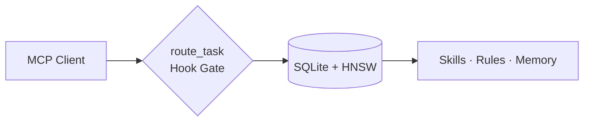

# agent-brain

Local MCP router that picks the right skills, rules, and memory for each agent turn (~500 tokens), and enforces `route_task` via host hooks.

Part of the [Autonomic AI](https://github.com/autonomic-ai-dev/agent-body) stack. Standalone over stdio for Cursor and other MCP hosts; optional cluster mode via `agent-nerves` / `autonomic serve-mcp`.



| Problem | Fix |
|---------|-----|
| Skill libraries blow the context window | `route_task` returns a small, ranked set |
| Soft “use skills” rules are ignored | Hooks block brain MCP tools until `route_task` |
| Conventions vanish between chats | `store_memory` + `must_apply` |

Full usage: [docs/USAGE.md](docs/USAGE.md) · Agent contract: [docs/AGENT-CONTEXT.md](docs/AGENT-CONTEXT.md) · Hosts: [docs/host-integration.md](docs/host-integration.md) · Architecture: [docs/architecture/README.md](docs/architecture/README.md)

---

## Install

Apple Silicon (Developer ID–signed release):

```bash
curl -fsSL https://raw.githubusercontent.com/autonomic-ai-dev/agent-brain/master/scripts/install.sh | bash -s -- --global
```

```bash
agent-brain version
agent-brain doctor
```

`install --global` writes MCP config, hooks, and mode snippets. Paste `~/.agent_brain/cursor-user-rules.mdc` into Cursor **User Rules**. The host spawns `serve` — you do not run it manually.

Local build: `make release-macos` (required for Cursor MCP), then `agent-brain install --global`.

Other hosts:

```bash
agent-brain install --all --global
# or: --claude-code | --codex | --opencode | --gemini | --antigravity | --vscode | --claude-desktop
```

Packages: `agent-brain registry list` · `agent-brain add @supervisor`

---

## Commands

| Command | Purpose |
|---------|---------|
| `install --global` | MCP + hooks + permissions |
| `add <pkg\|owner/repo>` | Install skill package |
| `doctor` / `doctor --fix` | Health check (clears quarantine; does not re-sign) |
| `briefing` | Last `route_task` summary |
| `index` | Reindex skills/rules/memory |
| `sync git\|cloud …` | Multi-machine brain sync |

---

## Data

Default store: `~/.autonomic/memory/` (`brain.db`, packages, route logs). Override with `AGENT_BRAIN_HOME`. First start downloads the embedding model (~90MB).

---

## Development

```bash
cargo test --release -p agent-brain
make release-macos
```

Release CI publishes **`agent-brain-aarch64-apple-darwin`** only (signed at build). Install verifies the signature and never re-signs.

---

## License

MIT · [CHANGELOG](CHANGELOG.md)
