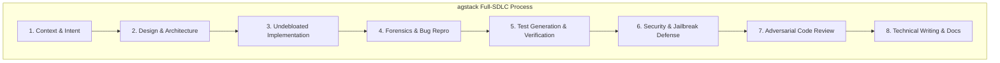

# agstack mode: Full-SDLC Engineering Operating System

`agstack` (Abhiuday Gupta Stack) transforms agent execution into an unbreakable, end-to-end Software Development Lifecycle (SDLC) process. It equips coding agents to handle every phase—from understanding intent and system design to writing undebloated code, forensics, test suite generation, and adversarial review.

---

## The 11 SDLC Playbooks

| Phase | Playbook | Purpose & Invariant |
|---|---|---|
| **Context** | [`context-and-intent`](playbooks/context-and-intent.md) | Interrogate design docs, ADRs, and git history; extract problem intent without asking the user. |
| **Design** | [`design-and-architecture`](playbooks/design-and-architecture.md) | Ground in existing repository patterns; design deep interfaces; model domain before logic. |
| **Defect** | [`bug-fix`](playbooks/bug-fix.md) | Parse stack traces; build failing runtime reproduction first; fix root cause; pair with regression test. |
| **Feature** | [`feature`](playbooks/feature.md) | Model domain data shape; author 4-H2 contract & 4-part steps; TDD; pair with functional Hurl suite. |
| **Refactor** | [`refactoring`](playbooks/refactoring.md) | Baseline tests must pass; subtract debloat; collapse wrappers; enforce immutability; prove invariance. |
| **Testing** | [`test-suite-generation`](playbooks/test-suite-generation.md) | Author targeted unit tests + declarative Hurl suites for changed code; maintain 1:1 step coverage. |
| **Security** | [`security-and-jailbreak-defense`](playbooks/security-and-jailbreak-defense.md) | Threat modeling, delimiter isolation, jailbreak/injection defense, secrets audit, SAST & dependency scans. |
| **Review** | [`code-review`](playbooks/code-review.md) | Adversarial audit (security, concurrency, error paths); verify blast radius; zero test weakening. |
| **Docs** | [`technical-writing`](playbooks/technical-writing.md) | Layered documentation standard (Diátaxis, Google Dev style, STE); real symbols; zero AI fluff. |
| **Delivery** | [`pull-request`](playbooks/pull-request.md) | Atomic chunked commits; rich description with HLD Mermaid charts, LLD, blast radius, evidence record. |
| **Explore** | [`prototype`](playbooks/prototype.md) | Settle architectural forks and performance trade-offs empirically; clean disposal. |
| **Execution** | [`autonomous-run`](playbooks/autonomous-run.md) | Milestone decomposition; hard gate stop on any failure; self-contained evidence record. |

---

## Core Principles Grounding Every Playbook

Every step in every playbook is strictly governed by the core principles:
1. **Foundational Thinking (`skills/principles/foundational-thinking/`):** Types, entities, and state machines come first. Make illegal states unrepresentable.
2. **Boundary Discipline (`skills/principles/boundary-discipline/`):** Validate at system edges (Zod/serde); trust internal typed models.
3. **Immutability First (`skills/principles/immutability-first/`):** Never mutate in place; always return updated copies.
4. **Smallest Complete Change & Token Efficiency (`skills/principles/smallest-complete-change/`):** Inspired by ponytail — rethink if code is needed; reuse existing repo code, standard library, or installed dependencies; small blast radius.
5. **Test Behavior Not Implementation (`skills/principles/test-behavior-not-implementation/`):** Verify observable outcomes; mock only true external boundaries.
6. **Fix Root Causes (`skills/principles/fix-root-causes/`):** Attack the premise; never patch around symptoms or write workaround sermons.
7. **Never Block on the Human (`skills/principles/never-block-on-human/`):** Interrogate the codebase and run empirical experiments. Never ask what the code or tests can answer.
