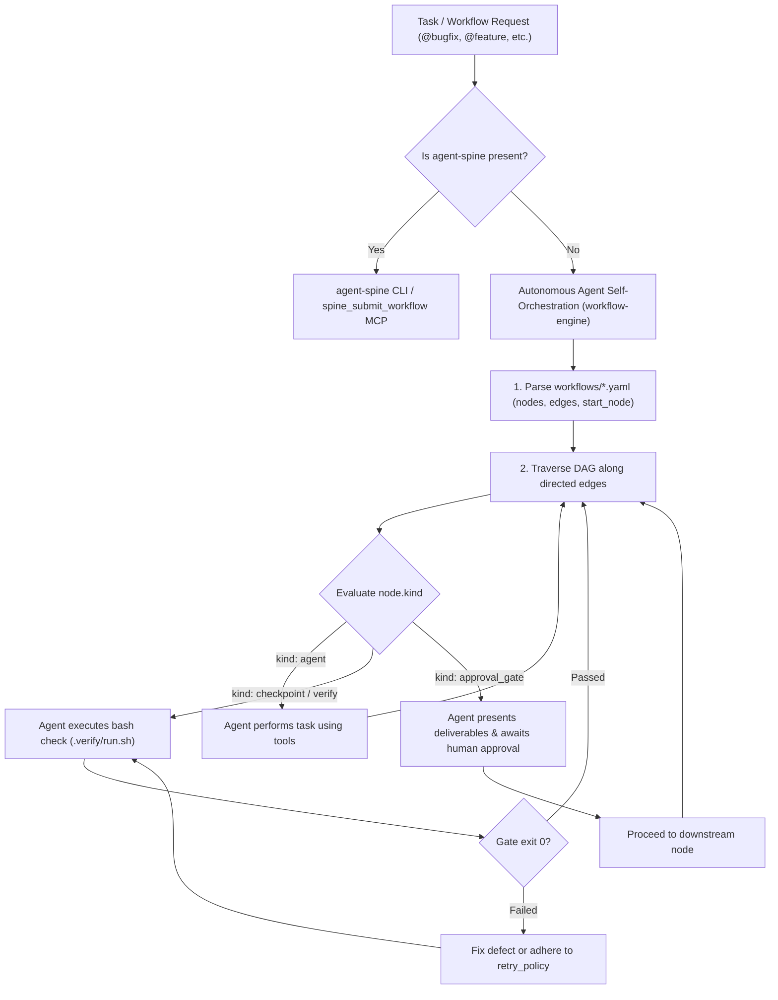

# Autonomous Workflow Engine: Zero-Dependency DAG Execution

`agstack` workflows (`workflows/*.yaml`) define declarative State Machine and Directed Acyclic Graph (DAG) processes for bug reproduction, feature delivery, stacked PRs, release notes, and system audits.

When `agent-spine` is installed and operational, workflows can be orchestrated via `agent-spine run` or the `spine_submit_workflow` MCP tool. **When `agent-spine` is not present, any coding agent (Antigravity CLI, Cursor, Claude Code, OpenCode, Codex, Copilot) can self-orchestrate and execute these workflows natively.**

---

## 1. Dual-Mode Execution Architecture



---

## 2. Agent Self-Orchestration Protocol

When executing a workflow without `agent-spine`, the agent acts as the workflow engine:

### Step 1: Load and Validate Workflow Specification
1. Read the target workflow YAML file from `workflows/<name>.yaml` (e.g. `workflows/bugfix.yaml` or `workflows/feature.yaml`).
2. Identify:
   - `start_node`: The initial node to execute.
   - `nodes`: The dictionary/list of nodes, their `kind`, and `description`.
   - `edges`: The directed transitions (`from: A, to: B`).
3. Announce the active workflow to the user:
   ```text
   ==> [Workflow: <name>] Initializing autonomous execution at start_node: <start_node>
   ```

### Step 2: Traverse and Execute Nodes
Maintain an active node pointer starting at `start_node`. For each node:

#### A. When `kind: agent`
- Read the node `description` carefully. This is your strict task specification for this step.
- Execute the objective using your available tools (file reads, edits, bash commands, searches).
- Do not jump ahead to subsequent nodes until the current node's invariant is completely met.
- Example (`Reproduce` in `@bugfix`): Write a failing test that reproduces the bug with concrete runtime output before touching production code.

#### B. When `kind: checkpoint` or `kind: verify`
- Extract the automated check specified in `description` (e.g. `bash .verify/run.sh <feature>`, `checks/feature_coverage.sh`, `./packages/agstack/scripts/check-added-comments.sh`, or project test runners).
- Execute the command directly in the workspace shell.
- Inspect the exit code and output:
  - **Exit 0 (PASS):** Log the proof artifact to `.verify/artifacts/` and proceed along the downstream edge.
  - **Non-zero (FAIL):** Do NOT bypass the gate. Adhere to `retry_policy` (up to `max_attempts`), diagnose the failure, fix the underlying code, and re-run until clean exit code 0 is achieved.

#### C. When `kind: approval_gate`
- Human approval gates represent consequential checkpoints (e.g., code review, pull request creation, release publishing).
- **Hard Rule:** Never proceed past an `approval_gate` autonomously without explicit user confirmation.
- Present a structured summary of deliverables:
  1. High-Level Design (HLD) with Mermaid diagram.
  2. Low-Level Design (LLD) schema/contract changes.
  3. Evidence record with commands, exit codes, and coverage metrics.
- Output:
  ```text
  ==> [Approval Gate: <NodeName>] Awaiting user approval to proceed.
  Review the deliverables above. Reply 'approved' or specify adjustments to continue.
  ```
- Pause execution until the user responds.

### Step 3: Advance Along Edges
- Look up the edge where `from: <current_node>`.
- Set `current_node = edge.to`.
- If no outgoing edge exists, the workflow has reached completion.
- Emit a final workflow completion summary with links to all artifacts and verification logs.

---

## 3. Workflow State Logging

During self-orchestration, the agent should record progress in `.verify/artifacts/workflow-state.json` (or context memory):

```json
{
  "workflow": "bugfix",
  "started_at": 1792667400000,
  "current_node": "Fix",
  "history": [
    {
      "node": "Reproduce",
      "kind": "agent",
      "status": "completed",
      "evidence": "Failing test added in internal/verify/repro_test.go"
    },
    {
      "node": "Isolate",
      "kind": "agent",
      "status": "completed",
      "evidence": "Root cause identified in token parsing boundary"
    }
  ]
}
```

---

## 4. Standalone CLI Runner (`run-workflow.sh`)

For developers or environments where a shell utility is preferred, `agstack` provides a zero-dependency portable runner:

```bash
# Validate any workflow YAML
bash packages/agstack/scripts/run-workflow.sh validate workflows/feature.yaml

# Inspect workflow structure and node sequence
bash packages/agstack/scripts/run-workflow.sh inspect workflows/bugfix.yaml

# Run workflow interactively
bash packages/agstack/scripts/run-workflow.sh run workflows/bugfix.yaml

# Run with auto-approval for non-interactive CI runs
bash packages/agstack/scripts/run-workflow.sh run workflows/bugfix.yaml --auto-approve
```

---

## 5. Curated Registry Workflows Reference

| Workflow File | Alias | Core Playbook | Nodes Overview |
|---|---|---|---|
| `workflows/bugfix.yaml` | `@bugfix` | `bug-fix` | Reproduce -> Isolate -> Fix -> Verify -> QualityGate -> Review |
| `workflows/feature.yaml` | `@feature` | `feature` | ContextAndIntent -> ModelDomain -> FeatureContract -> Implement -> VerificationSuites -> TestRun -> QualityGate -> SecurityGate -> ReviewGate -> Summary |
| `workflows/stacked-pr.yaml` | `@stacked-pr` | `pull-request` | InspectStack -> AtomicChunking -> VerificationGate -> RichDescription -> ApprovalGate -> PushBranch |
| `workflows/release-notes.yaml` | `@release-notes` | `technical-writing` | CollectDiff -> DraftNotes -> ReviewGate -> Publish |
| `workflows/mcp-health-check.yaml` | `@mcp-health-check` | `investigation` | AuditSchemas -> ProbeGateway -> VerifyRouting -> Report |
